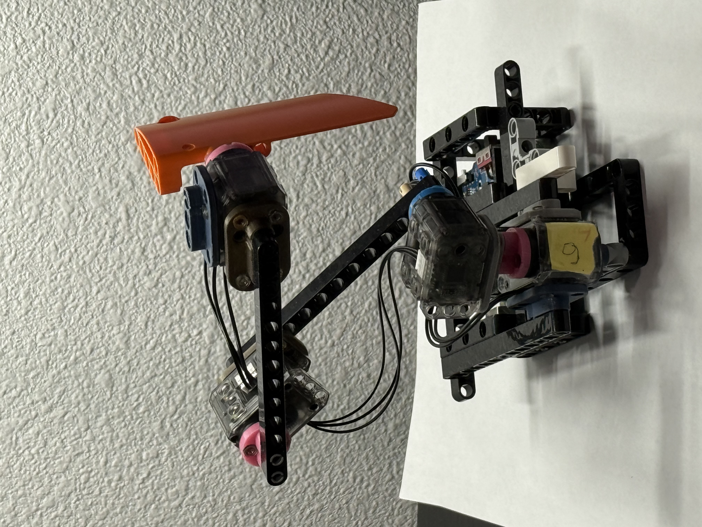
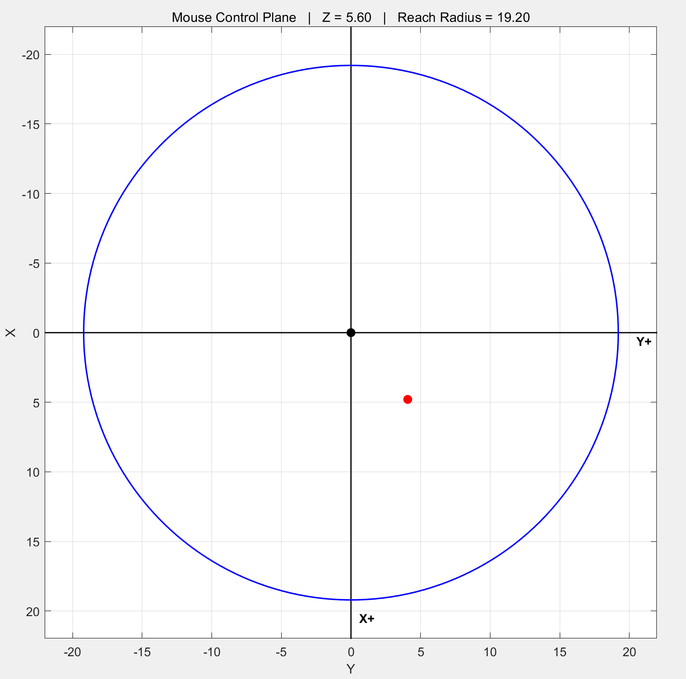
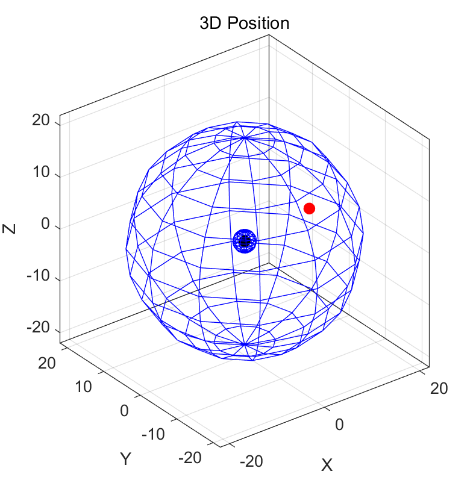

# Inverse-Kinematics-Robot-Gesture-ARM
A course lab project.

<video width="400" controls>
  <source src="https://raw.githubusercontent.com/LukeLiu2000/Inverse-Kinematics-Robot-Gesture-ARM/main/b293a466d7596babbb78964984078bba_raw.mp4" type="video/mp4">
</video>

[Download / open video](https://github.com/LukeLiu2000/Inverse-Kinematics-Robot-Gesture-ARM/raw/main/b293a466d7596babbb78964984078bba_raw.mp4)

   

<video width="400" controls>
  <source src="./videos/直线移动.mp4" type="video/mp4">
</video>

<video width="400" controls>
  <source src="./微信视频2026-04-29_043447_006.mp4" type="video/mp4">
</video>

For our project, we also designed an alternative robotic arm solution. This design features a robotic arm capable of pulling the robot forward. While it offers greater flexibility as an advantage, it [...]

We start from the planar, or two-dimensional, case. In this setup, the arm is modeled as a two-link manipulator with lengths L_1and L_2. We define two key angles, \alphaand \beta, which determine the [...]
Using forward kinematics, we can compute the end-effector position xyfrom these angles. More importantly, for control, we solve the inverse kinematics problem: given a target position xy, we compute t[...]
Once the planar control is established, we extend the system to three-dimensional space. The key idea is that the arm itself still operates in a plane, but we add an additional degree of freedom: rota[...]
To handle this, we introduce a cylindrical coordinate representation. Instead of directly controlling xyz, we convert it into ρθZ, where \rho=\sqrt{x^2+y^2}and \theta=\mathrm{atan2}(y,x). The angle [...]
Then, the remaining problem becomes a planar one again: we use ρZas inputs to the same inverse kinematics we derived earlier to compute \alphaand \beta.
So overall, the control pipeline is: we input a Cartesian position xyz, convert it into cylindrical coordinates, and then map it into servo angles θαβ. This allows the robotic arm to reach any poin[...]

Next, I will briefly introduce the communication between the high-level controller and the Arduino.
We use a UART serial interface to transmit control commands.
On the high-level side, either MATLAB or Python sends four parameters, which are floating-point values representing the target position and an additional control parameter.
To ensure reliable communication, we designed a simple but robust communication protocol.
Each data packet includes clear start and end markers, so that the Arduino can correctly identify and parse each message.
Another important point is that we use fixed-width formatting for the floating-point numbers.
This ensures that each parameter has a consistent length, which greatly reduces parsing errors during transmission.
During development, we found that without these design choices, the system would occasionally misread data or produce unstable behavior.
After refining the protocol, the communication becomes very stable, and we can achieve almost error-free data transmission.
